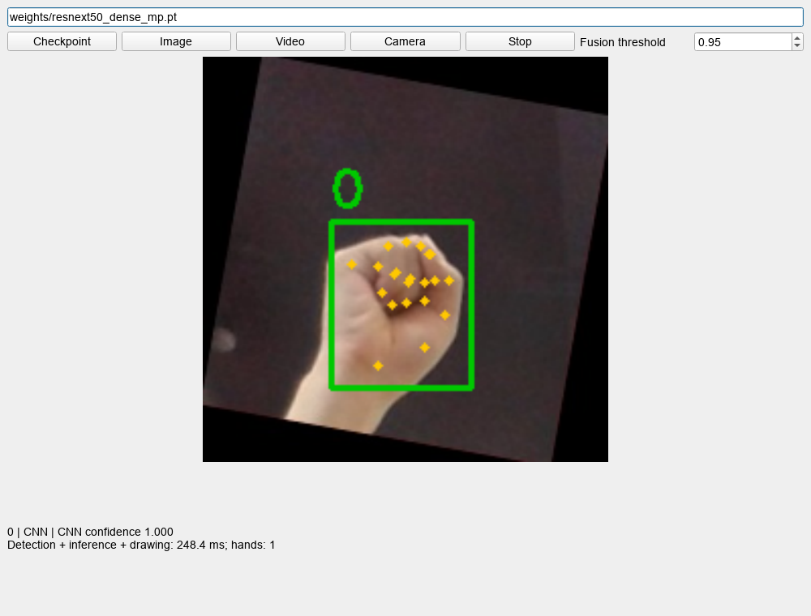
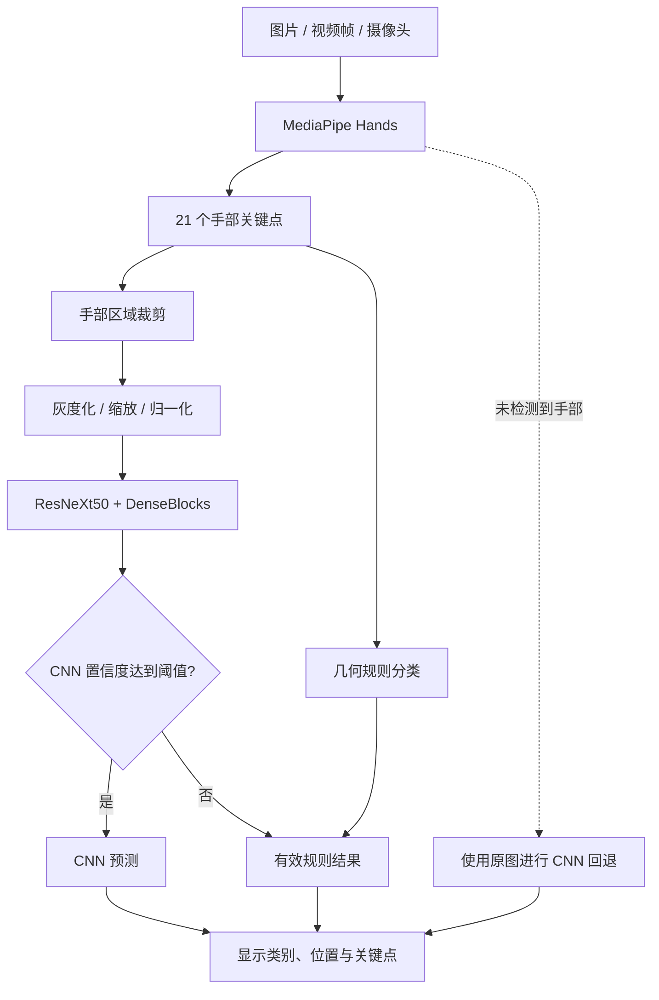

<div align="center">

# Hand Gesture Recognition

### 基于 MediaPipe · OpenCV · PyTorch 的手势识别系统

识别 **0–8 和 OK** 共 10 类静态手势，支持图片、视频与摄像头输入。


[快速开始](#快速开始) · [系统流程](#系统流程) · [实验结果](#实验结果) · [训练与评估](#训练与评估) · [项目结构](#项目结构)

</div>

## 项目概览

项目将手部关键点定位与图像分类结合：MediaPipe 提取手部关键点并确定裁剪区域，CNN 预测手势类别，再根据验证集选出的置信度阈值选择 CNN 或几何规则结果。

| 功能 | 说明 |
| :--- | :--- |
| 图片识别 | 读取单张图片，显示手部框、关键点和类别 |
| 视频识别 | 对视频逐帧识别，支持停止和切换输入 |
| 摄像头识别 | 实时采集与识别，推理在独立工作线程中执行 |
| 模型对比 | Plain CNN、ResNeXt50、ResNeXt50 + DenseBlocks |
| 完整流程评估 | 比较原图、手部裁剪、关键点规则与结果融合 |
| 数据与权重 | 提供数据划分、四组训练权重和实验结果 |

> 视频模式识别每一帧中的静态手形，不包含动态动作的时序建模。CNN 的输入为图片；关键点用于定位与几何规则。

## 界面预览



*使用已训练模型进行图片识别的实际界面。顶部可选择模型、输入来源和融合阈值。*

## 快速开始

### 1. 获取项目

```powershell
git clone https://github.com/2392496291/Computer-Vision-Gesture-Recognition-System.git
cd Computer-Vision-Gesture-Recognition-System
```

仓库包含数据与模型权重，下载体积较大。虚拟环境和预处理缓存不包含在仓库中。

### 2. 安装依赖

使用 **Python 3.11**。以下示例面向 Windows 与 NVIDIA GPU，所有命令在项目根目录执行：

```powershell
python -m venv .venv
$py = '.\.venv\Scripts\python.exe'
& $py -m pip install -r requirements.txt
& $py -B check_environment.py --require-cuda
```

<details>
<summary><b>没有 NVIDIA GPU：使用 CPU 环境</b></summary>

在已创建的环境中安装 CPU 版本 PyTorch，再安装通用依赖：

```powershell
& $py -m pip install torch==2.7.1 torchvision==0.22.1 --index-url https://download.pytorch.org/whl/cpu
& $py -m pip install -r requirements-gpu.txt
& $py -B check_environment.py
```

CPU 模式运行时使用 `--device cpu`。`requirements-gpu.txt` 包含 OpenCV、MediaPipe 等通用依赖；PyTorch 构建版本由上述命令单独选择。

</details>

### 3. 启动识别

```powershell
& $py app.py
```

默认加载 `weights/resnext50_dense_mp.pt` 和 `weights/fusion.json`，无需先训练模型。

| 界面按钮 | 操作 |
| :--- | :--- |
| **Image** | 选择图片 |
| **Video** | 选择视频 |
| **Camera** | 打开摄像头 |
| **Stop** | 停止当前输入 |
| **Checkpoint** | 切换模型权重 |

融合阈值默认为 **0.95**，由验证集选择。调整界面阈值后，从下一次启动输入时生效。

## 系统流程



规则无有效结果时保留 CNN 预测。评估中同时报告“原图回退”和“漏检直接拒识”两种策略，避免只统计成功检测的样本。

### 网络结构

| 模型 | 实现 |
| :--- | :--- |
| **Plain CNN** | 五个卷积阶段组成的基线网络 |
| **ResNeXt50** | torchvision ResNeXt-50 32×4d，保留完整骨干与分组卷积 |
| **ResNeXt50 + DenseBlocks** | 骨干后接投影层、两个 DenseBlock 与分类头；每块 4 层，增长率 32 |

Plain CNN 与 ResNeXt50 是不同骨干的模型对比；ResNeXt50 与增加 DenseBlocks 的版本用于检验新增模块的影响。

## 实验结果

**测试条件：**随机种子 42 · 从头训练 · 50 轮 · 相同数据划分。表中指标单位均为 **%**。

| Model / Pipeline | Accuracy | Macro Precision | Macro Recall | Macro F1 | mAP |
| :--- | ---: | ---: | ---: | ---: | ---: |
| Plain CNN / original | 96.75 | 96.58 | 94.76 | 95.61| 94.15 |
| ResNeXt50 / original | 98.30 | 95.97 | 94.20 | 94.57 | 94.15 |
| ResNeXt50 + DenseBlocks / original | 98.36 | 95.28 | 95.29 | 95.13 | 95.57 |
| MediaPipe crop + CNN / fallback | 98.41 | 95.65 | 93.89 | 94.24 | 96.64 |
| MediaPipe crop + CNN / strict rejection | 97.33 | 96.60 | 92.25 | 94.26 | 94.82 |
| CNN + landmark-rule fusion / fallback | **98.58 **| 97.29 | 97.95 | 98.54 | **97.60** |
| Landmark rules | 71.57 | 87.93 | 68.87 | 72.75 | 61.70 |


- 本次测试中，Plain CNN 的整体表现较好。
- 对最终网络使用手部裁剪后，分类 mAP 从 **95.48%** 提高到 **96.64%**。
- 在裁剪方案上加入规则融合后，Accuracy 从 **98.41%** 提高到 **98.58%**，Macro-F1 从 **94.24%** 提高到 **94.60%**，但分类 mAP 下降。

<details>
<summary><b>指标定义与实验范围</b></summary>

- **Accuracy**：全部测试样本中预测正确的比例。
- **Macro Precision / Recall / F1**：逐类计算后等权平均，用于观察类别不平衡下的整体表现。
- **分类 mAP**：逐类 one-vs-rest AP 的均值，不使用检测框 IoU 阈值，不等同于检测 mAP@0.5。
- **融合分数**：CNN 被选中时使用其概率，规则覆盖时使用 one-hot 分数；该分数不是校准置信度。
- 当前为单个随机种子的结果，尚无重复实验的方差估计，也未进行专门的光照或遮挡分组评估。
- 已清理像素完全相同的重复图片；尚未验证近重复或采集者跨集合的情况。

</details>

## 数据与权重

### 数据划分

原始标注图片 **32,355 张**，清理重复和标签冲突后保留 **32,348 张**：

| 训练集 | 验证集 | 测试集 | 类别 |
| :---: | :---: | :---: | :---: |
| 19,409 | 6,470 | 6,469 | 0–8、OK |

```text
data/dataset_split/
├── train/
│   ├── 0/ ... 8/
│   └── OK/
├── val/
│   ├── 0/ ... 8/
│   └── OK/
└── test/
    ├── 0/ ... 8/
    └── OK/
```

类别数量不均衡。数据准备仅调整训练清单，不删除原图片；冲突与排除记录保存在 `prepared/audit.json`。

### 模型权重

以下为本项目从头训练得到的权重，不是 ImageNet 初始化权重：

| 文件 | 模型 / 输入 |
| :--- | :--- |
| `weights/plain_cnn.pt` | Plain CNN / 原图 |
| `weights/resnext50.pt` | ResNeXt50 / 原图 |
| `weights/resnext50_dense_raw.pt` | ResNeXt50 + DenseBlocks / 原图 |
| `weights/resnext50_dense_mp.pt` | ResNeXt50 + DenseBlocks / 手部裁剪 |
| `weights/fusion.json` | 默认融合阈值与模型配置 |

## 训练与评估

### 一键完成实验

准备裁剪缓存、运行四组训练、选择融合阈值并汇总：

```powershell
& $py run_all.py --seed 42 --epochs 50 --batch-size 32 --device cuda
```

已有设置一致的完整实验会被跳过。预处理缓存不存在时自动生成。

<details>
<summary><b>分步运行命令</b></summary>

```powershell
# 数据检查与手部裁剪缓存：首次运行
& $py prepare_data.py --clean-duplicates

# 四组模型训练
& $py train.py --model plain_cnn --view raw --seed 42 --device cuda
& $py train.py --model resnext50 --view raw --seed 42 --device cuda
& $py train.py --model resnext50_dense --view raw --seed 42 --device cuda
& $py train.py --model resnext50_dense --view mp --seed 42 --device cuda

# 完整流程评估与汇总
& $py evaluate_pipeline.py --checkpoint runs/resnext50_dense_mp_seed42/best.pt --raw-checkpoint runs/resnext50_dense_raw_seed42/best.pt --output reports/pipeline_seed42 --device cuda
& $py summarize.py
```

`prepare_data.py` 不会覆盖已有清单。修改实验设置或重新运行已有模型时，指定新的 `--output`。

</details>

### 训练设置

| 项目 | 设置 |
| :--- | :--- |
| 输入 | 64×64；灰度图复制为三通道 |
| 数据增强 | 30% 概率水平翻转、±10° 随机旋转 |
| 损失 / 优化器 | Cross-Entropy / Adam |
| 初始学习率 / Batch size | 0.001 / 32 |
| 权重选择 | 验证集 Macro-F1 最佳模型 |
| 测试 | 重新加载最佳权重后评估 |
| 融合阈值 | 只在验证集选择 |

### 本地输出

```text
prepared/                  # 数据清单、审计记录、手部裁剪缓存
runs/<model>_<view>_seed42/
├── best.pt                # 最佳权重
├── config.json            # 实验配置
├── history.csv            # 逐轮记录
└── test_metrics.json      # 测试指标与混淆矩阵
reports/
├── pipeline_seed42/       # 完整流程评估与逐图预测
└── comparison/            # 模型与流程结果汇总
```

## 项目结构

```text
.
├── app.py                 # 图片、视频与摄像头界面
├── models.py              # CNN、ResNeXt50、DenseBlocks
├── hands.py               # MediaPipe 定位与几何规则
├── inference.py           # 权重加载与结果融合
├── common.py              # 预处理与数据加载
├── prepare_data.py        # 数据审计和裁剪缓存
├── train.py               # 训练与测试
├── metrics.py             # 分类评价指标
├── evaluate_pipeline.py   # 验证集选阈值与流程评估
├── summarize.py           # 实验汇总
├── run_all.py             # 实验入口
├── data/dataset_split/    # 数据划分
├── weights/               # 已训练模型
├── assets/                # 演示素材
├── results/               # 公开实验结果
└── docs/images/           # 界面截图
```

## 参考实现

- [torchvision · ResNeXt50](https://docs.pytorch.org/vision/0.19/models/generated/torchvision.models.resnext50_32x4d.html)
- [torchvision · DenseNet](https://docs.pytorch.org/vision/0.19/_modules/torchvision/models/densenet.html)
- [MediaPipe · Hands](https://chuoling.github.io/mediapipe/solutions/hands.html)
